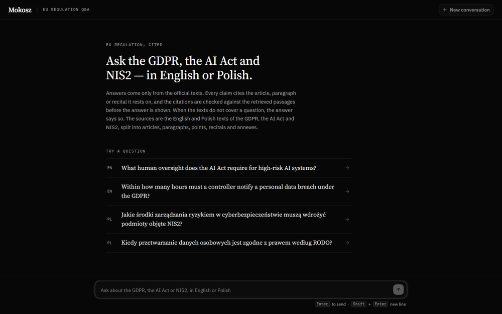
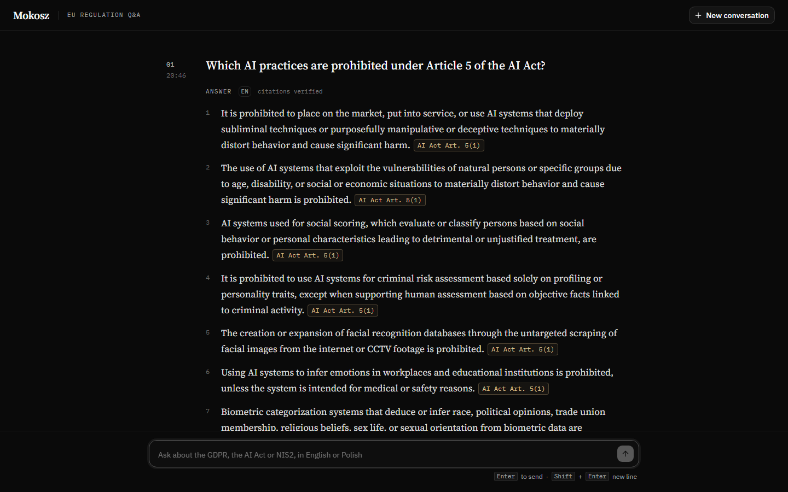

# Mokosz

An agent harness that runs fully on local models and answers questions about the GDPR, the
AI Act and NIS2 with exact, verified citations. Every run is stored with its steps, tokens,
cost and latency.

> Mokosz is a research project, not legal advice. Answers can be wrong or incomplete even
> when every citation checks out; read the cited article before relying on it.





## About

Mokosz is a TypeScript and [Mastra](https://mastra.ai) port of the author's earlier, unpublished
Python implementation of the same app. It was built with coding agents under the process in
[`AGENTS.md`](AGENTS.md) and [`.claude/`](.claude/); the owner's decisions are recorded in
[`docs/decisions/`](docs/decisions/). [`SPEC.md`](SPEC.md) describes what is built and what is
not.

Invoice extraction with human review is the unfinished part of v1. The invoice schema, the
validator, the database table and its store, and a generated set of fictional invoices exist;
there is no extraction workflow, API or screen yet.

## Requirements

- Node.js 24
- Docker (for Postgres with pgvector)
- [Ollama](https://ollama.com)

The default profile, `local-qwen`, runs `qwen3.6:27b` (see [`profiles/`](profiles/)) and needs
a GPU with roughly 24 GB of memory. `local-gemma` runs `gemma4:26b` instead. The other alternative is the `cloud-claude` profile
(`claude-haiku-5-5` and `claude-sonnet-5-5`), which needs `ANTHROPIC_API_KEY`. Copy
`.env.example` to `.env` and set `DEFAULT_PROFILE=cloud-claude` and the key there. Ollama is
needed with either profile: questions are embedded locally with `bge-m3`.

## Quickstart

It needs two terminals, because `serve` keeps running. In the first, from the repository root:

```sh
npm install
npx mokosz setup
npx mokosz serve
```

`mokosz setup` checks Docker and Ollama, pulls the models of the default profile and `bge-m3`,
starts Postgres, and migrates and seeds the database. In the second terminal:

```sh
cd web
npm install
npm run dev
```

The UI runs at <http://localhost:5173> and talks to the API on `127.0.0.1:8000`.

The API has no authentication. It listens on loopback by default and then accepts only
loopback `Host` headers; `npx mokosz serve --host 0.0.0.0` exposes it to the whole network
and turns that check off.

## Development

```sh
docker compose up -d          # Postgres + pgvector on 127.0.0.1:5433
npm test                      # Vitest; needs that Postgres (hook tests alone: npm test -- --project hooks)
npm run lint
npm run format:check
npm run typecheck
cd web && npm run lint && npm run build
```

- The tests create and drop their own database on that server. LLM calls use AI SDK mock
  models, so no model or network is needed.
- Contributors: enable the commit-msg hook, which checks the commit format in
  [`docs/reference/commit-format.md`](docs/reference/commit-format.md), once per clone with
  `git config core.hooksPath .githooks`.
- `npm run mutation` runs StrykerJS over the pure modules; it is slow and not a gate.
- `.env` is read from the working directory with Node's `util.parseEnv`. A value containing `#`
  must be quoted, otherwise the rest of the line is a comment. Names are exact and upper-case
  (`DATABASE_URL`, `OLLAMA_BASE_URL`, `DEFAULT_PROFILE`, `ANTHROPIC_API_KEY`), and there is no
  `${VAR}` expansion.

`npx mokosz --help` lists every command; each has its own `--help`.

## Architecture

The UI talks to a small Hono API. A new message starts a run: the executor drives the Mastra
workflow in the background and stores each step's events, which the UI follows over SSE. The
workflow routes the question, retrieves chunks by vector search, asks the answerer, and checks
every citation deterministically before the answer is shown. Postgres holds the chunks, the
runs and their events, and Mastra's Memory and workflow state.

```text
web (Vite + React)
  │ /api, SSE
  ▼
Hono API ──► runs (executor, events, SSE)
               │
               ▼
Mastra workflow:  router ──► retriever ──► answerer ──► verifier
                    │           │             │
                    ▼           ▼             ▼
                  chat LLM   embed query   chat LLM
                             (Ollama bge-m3),
                             then pgvector search

chat LLM: Ollama or Anthropic, per profile
Postgres: chunks (pgvector), runs, run_events, Mastra Memory and workflow state
```

## Screenshots

The images above come from `mokosz screenshots`, never by hand. It needs the API, a built UI
and Chromium. With `npx mokosz serve` running in one terminal, serve the built UI in a second:

```sh
cd web
npm run build
npx vite preview
```

Then, in a third terminal, from the repository root:

```sh
npx playwright install chromium
npx mokosz screenshots
```

`chat.png` shows the latest conversation with an answer, or the one given with
`--conversation <uuid>`. `chat.gif` records `--question` being asked in a new conversation, so
each run adds one. The committed images were taken with `--conversation` set to an earlier AI
Act conversation and `--question "Within how many hours must a controller notify a personal
data breach under the GDPR?"`.

## Evals

`mokosz eval` asks every question in `evals/qa/items.json` through the real workflow and scores
the answer's citations against the expected chunks:

```sh
npx mokosz eval --profile local-qwen   # --repeat N to ask each question N times
```

It writes `evals/results/{YYYY-MM-DD-HHMM}-{profile}-qa.csv` (one row per question) and
`evals/results/{YYYY-MM-DD-HHMM}-{profile}.md` (the summary). Every question is a real
conversation in the database, so it shows up in the chat history. First run, `local-qwen` on an
RTX 4090, 30 questions (15 EN, 15 PL; 25 answerable, 5 outside the three regulations), one
repeat:

| Metric | Value |
| --- | --- |
| Citation precision (macro / micro) | 0.80 / 0.73 |
| Citation recall (macro / micro) | 0.82 / 0.80 |
| Out-of-scope questions answered "not found" | 5 / 5 |
| Answerable questions wrongly answered "not found" | 1 / 25 |
| Latency p50 / p95 (after one warm-up) | 5.2 s / 8.4 s |

Source: [`evals/results/2026-11-04-2141-local-qwen.md`](evals/results/2026-11-04-2141-local-qwen.md).

The questions, expected chunks and reference answers were written by a model from the
regulation texts. A test checks that every expected chunk exists and contains the quoted
evidence; whether that evidence supports the answer is the model's judgement. No lawyer has
reviewed the set. It is small and some of its expected chunks also appear in the retrieval
eval, so treat the numbers as a smoke test rather than a benchmark.

## Data

The regulation texts come from [EUR-Lex](https://eur-lex.europa.eu) via the Publications
Office Cellar service. They are the original texts published in the Official Journal, not the
consolidated versions.

## Licence

- The code is licensed under the [EUPL-1.2](LICENSE).
- `src/invoices/fonts/` holds Noto Sans, under the SIL Open Font License 1.1
  ([`OFL.txt`](src/invoices/fonts/OFL.txt)). The web UI bundles IBM Plex Sans, IBM Plex Mono
  and Source Serif 4, also under the SIL OFL 1.1.
- `data/raw/` and the embeddings derived from it in `data/embeddings/` are © European Union,
  reused under Commission Decision 2011/833/EU.
- `data/invoices/` is fictional, generated data: the companies, addresses, tax ids and amounts are invented.
